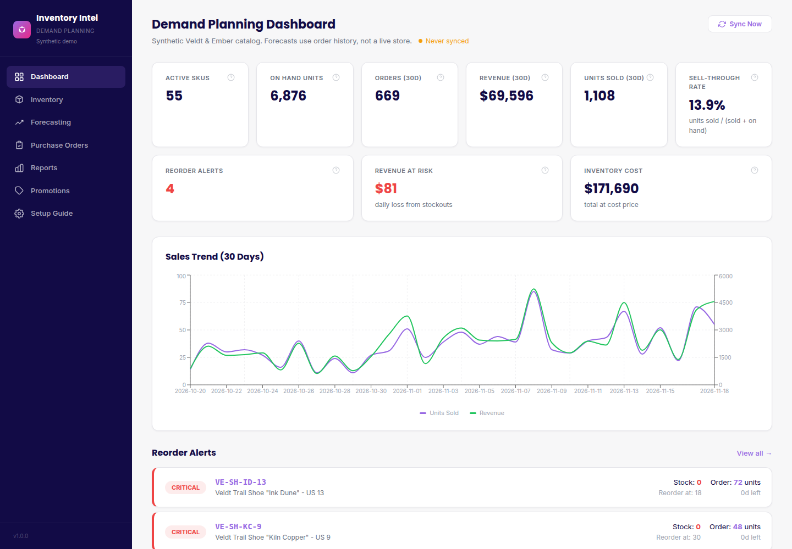
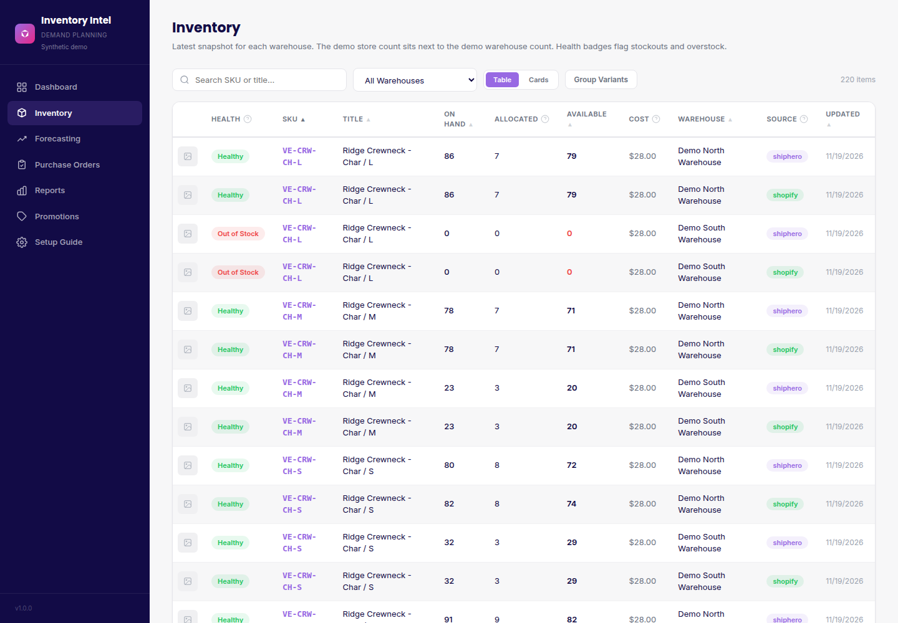
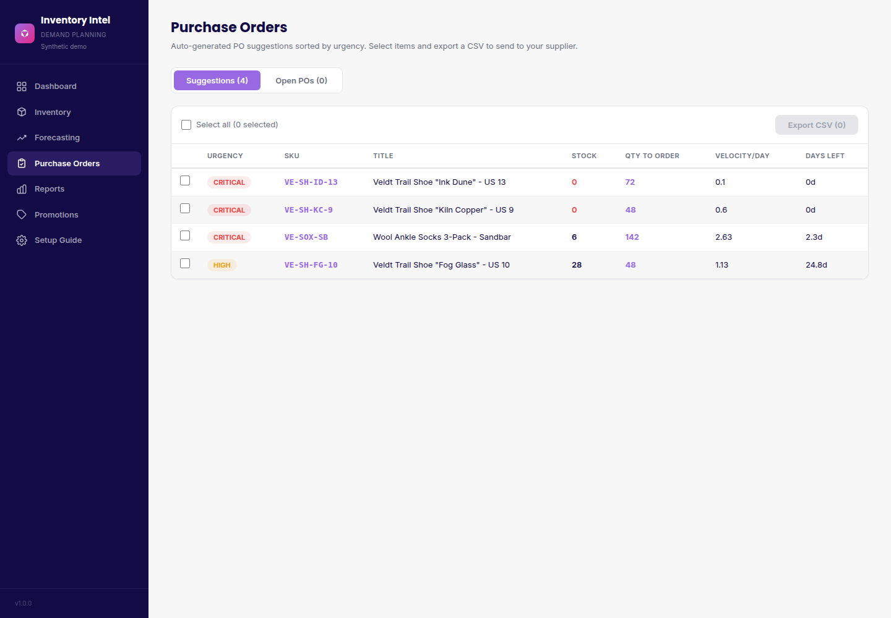
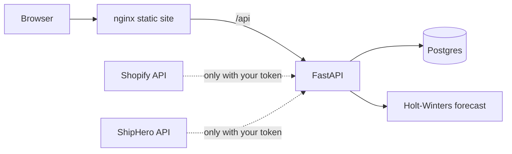

# Inventory Intel

A personal spare-time project that forecasts SKU demand, flags stockouts, and suggests purchase orders.

Corbin Szenegeto built this to practice a full stack (FastAPI, React, Postgres, Docker) on a planning problem: given order history and what is in the warehouse, what should be reordered, and how soon. The catalog that ships with the app is invented. It is not a store, and this repository is not a hosted product.



## Quick start

Docker is the one command. It starts Postgres, the API, and the site, and loads the demo catalog into an empty database.

```bash
docker compose up --build
```

Open http://localhost:8080. The API is on port 8000 if you want the interactive docs at http://localhost:8000/docs.

The first launch fits a forecast the first time you open Forecasting or Purchase Orders. That pass is the slow one; the result is cached for 30 minutes.

To run the processes yourself instead of in containers:

```bash
cd backend
python -m venv .venv
source .venv/bin/activate
pip install -r requirements.txt
python -m seed
python -m uvicorn app.main:app --host 127.0.0.1 --port 8000

cd frontend
npm install
npm run dev
```

The Vite dev server is http://localhost:5173 and proxies `/api` to port 8000. `python -m seed` writes a SQLite file, `backend/inventory.db`.

## Run it yourself / host it yourself

Nothing in this repo deploys the app. There is no live site, and there is no config that publishes one when you push.

To run it on a machine you control:

1. Copy `.env.example` to `.env`.
2. Set `USE_SQLITE=false`, point `DATABASE_URL` at your Postgres, and set `SECRET_KEY` and `POSTGRES_PASSWORD` to values you choose.
3. Leave the Shopify and ShipHero tokens as `replace-me` unless you want the sync jobs to call those APIs with your own credentials.
4. `docker compose up --build`.
5. If anyone besides you should open it, put your own TLS reverse proxy in front of port 8080. Do not commit real tokens.

The Dockerfiles are production-style: the API runs under uvicorn without reload, and the React app is a built bundle served by nginx. nginx proxies `/api` to the `backend` service.

## What you can do in the demo

- Dashboard totals: units on hand, 30-day orders and revenue, sell-through, reorder count, and a rough daily revenue figure for SKUs that are already at zero.
- A year of synthetic orders, so the sales chart and the forecasts have a history.
- Inventory by warehouse, plus a comparison of the demo "store" count and the demo "warehouse" count.
- A 30/60/90 day forecast per SKU, and a reorder suggestion when stock will not cover supplier lead time.
- ABC labels, dead stock, and excess stock, each exportable as CSV.
- A small promotion calendar. Those rows are stored and shown. They are not fed into the forecast.





## Architecture



Local `uvicorn` uses SQLite instead of Postgres. The same schema is created on startup.

## How forecasting works

For each SKU the app builds a daily sales series for the last year and fills days with no orders as zero. A day that is wildly above the SKU's usual sales is pulled back to the average, so one bulk order does not set the forecast. If about two months of history show a weekly or monthly repeat, Holt-Winters exponential smoothing is fit with a weekly seasonal term. Otherwise it is fit with a trend only. Fewer than two weeks of history, or a fit that fails, falls back to "recent daily average times the number of days."

The reorder point is that recent daily rate times the supplier lead time, plus safety stock. A saved rule can raise the point, not lower it. The suggested buy covers about eight weeks of that daily rate, minus what is already on hand. Urgency is how that runway compares with lead time: inside the lead time is critical, inside 1.5x is high, inside 2x is medium, and beyond that is low.

Stock is the newest count in each warehouse, added together. Older snapshots stay in the table so a later sync does not erase history, but they are not treated as extra units.

## Tests

GitHub Actions on `main` and on pull requests runs:

- Backend: ruff, black, mypy, pytest with coverage
- Frontend: eslint, vitest, production build
- `docker build` for the API image and the nginx image

```bash
cd backend
pip install -r requirements.txt -r requirements-dev.txt
pytest

cd frontend
npm ci
npm test
npm run lint
npm run build
```

## Limits

- One catalog, no login, no tenants.
- Promotions are a calendar only. The forecast does not raise or lower demand for them.
- The first forecast of the full demo catalog is a statsmodels fit per SKU. Later loads in that process use a 30-minute memory cache.
- Shopify and ShipHero sync are optional and read-only in the sense that this app does not push orders back. With the placeholder tokens, those jobs do not call out.
- ABC, dead stock, and excess stock are straightforward revenue and coverage rules, not a causal model.
- This is a portfolio project built in spare time. It does not have customers, and the numbers on the screen are the synthetic catalog.

## License

[MIT](LICENSE)
